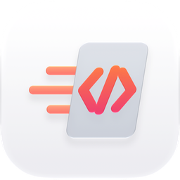
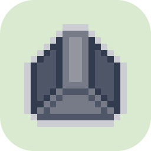
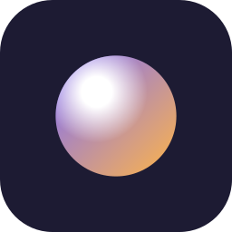
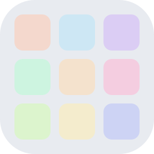

Hi there, it's Javi 👋

Senior full-stack software and product engineer in Berlin, focused on UX, web standards, performance, developer
experience and AI-assisted workflows. Lately I've been building small, focused apps for the Mac and the web. Most of
them are open source.

<!-- The grid below is generated from https://itsjavi.com/catalog.json by .github/workflows/readme.yml. -->
<!-- projects:start -->
<table>
  <tr>
    <td align="center" valign="top" width="25%"><a href="https://itsjavi.com/notemd/"> <b>NoteMD</b></a> Markdown notes, versioned with git</td>
    <td align="center" valign="top" width="25%"><a href="https://itsjavi.com/lamina/"> <b>Lamina</b></a> Photo editing for the Mac</td>
    <td align="center" valign="top" width="25%"><a href="https://itsjavi.com/quickedit/"> <b>QuickEdit</b></a> Quick, safe edits for code and text</td>
    <td align="center" valign="top" width="25%"><a href="https://itsjavi.com/autotiler/"> <b>Autotiler</b></a> Blob tilesets for Godot and Tiled</td>
  </tr>
  <tr>
    <td align="center" valign="top" width="25%"><a href="https://pokepc.net/"> <b>PokéPC</b></a> Pokédex tracker and trainer network</td>
    <td align="center" valign="top" width="25%"><a href="https://itsjavi.com/lumiose/"> <b>Lumiose</b></a> Feels like React, runs like vanilla JS</td>
    <td align="center" valign="top" width="25%"><a href="https://itsjavi.com/storylite/"> <b>StoryLite</b></a> A lightweight Storybook alternative</td>
    <td align="center" valign="top" width="25%"><a href="https://itsjavi.com/projects/libraries/"> <b>Libraries</b></a> 9 small packages</td>
  </tr>
</table>
<!-- projects:end -->

I also maintain production libraries at [@dendrell](https://github.com/dendrell), and designed the
[official CSS logo](https://github.com/CSS-Next/logo.css).

[Website](https://itsjavi.com) · [Writing](https://itsjavi.com/blog/) ·
[Bluesky](https://bsky.app/profile/itsjavi.com) · [Mastodon](https://mastodon.social/@itsjavi) ·
[LinkedIn](https://www.linkedin.com/in/itsjavi)
